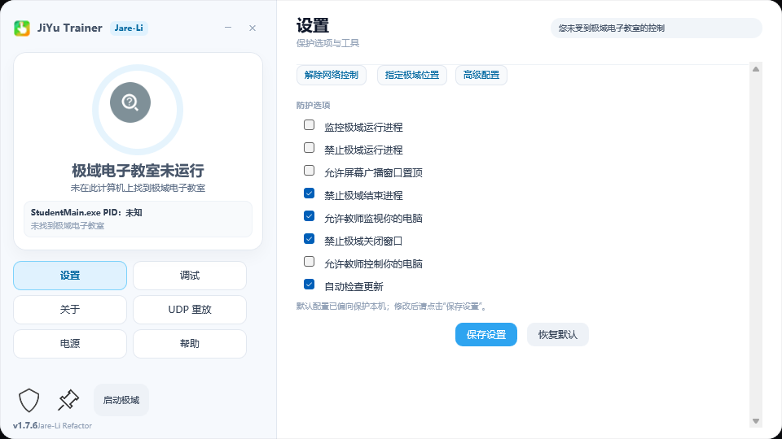
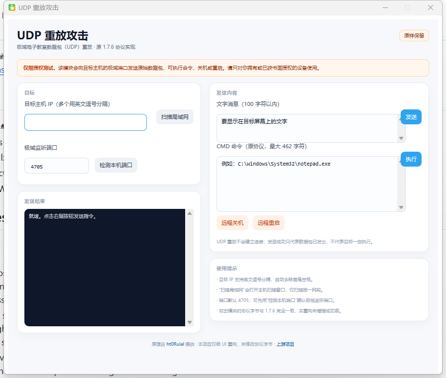
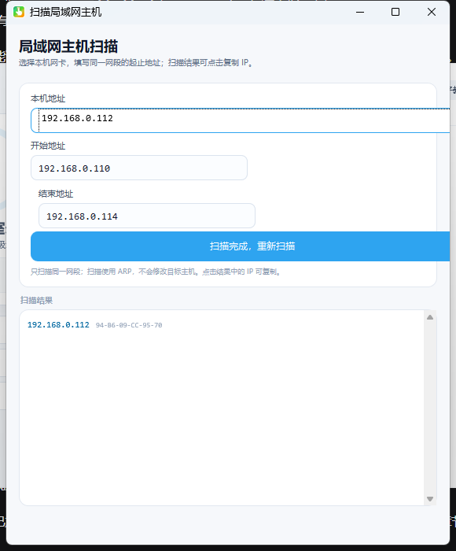

# JiYu Trainer 1.7.8 — Jare-Li Refactor

> 基于 [imengyu/JiYuTrainer](https://github.com/imengyu/JiYuTrainer) 1.7.6（MIT License）的重构版。
> 原版权归 **快乐的梦鱼（imengyu）** 所有；重构、UI、构建与测试由 **Jare-Li** 维护。



| UDP 重放 | 局域网扫描 |
|---|---|
|  |  |

## 特性

- **16:9 主界面**：960×540，左侧状态卡片 + 功能导航，右侧功能内容
- **UDP 重放**：896×760 左右分栏，保留原 1.7.6 协议字节与全部功能
- **局域网扫描**：580×700，ARP 扫描、起止地址校验、结果可复制
- 全屏广播转窗口、反控制、反监视、防结束进程、防关闭窗口
- 强杀 / 重启 `StudentMain.exe`、读取极域密码、卸载网络过滤驱动
- 托盘、全局热键、自动检查更新
- 单 exe 自解压，内置 Hook DLL、驱动与 Sciter 运行时

> UDP 重放模块可以向目标主机发送命令、关机或重启请求。请仅对自己拥有或已获得明确授权的设备使用。

## 构建

环境要求：

- Windows 10/11
- Visual Studio 2022（MSVC v143）
- Windows 10/11 SDK
- PowerShell 5.1+ / 7
- Python 3.9+（测试）

```powershell
.\build.ps1 -Sign
python tests\run_tests.py
```

输出：

```text
dist\JiYuTrainer.exe
dist\JiYuTrainerHooks.dll
dist\sciter.dll
JiYuTrainer-JareLi-1.7.8.zip
```

## 测试

当前回归结果：

```text
74/74 passed, 0 failed, 100.0%
```

覆盖范围：

- IPv4 校验、目标列表解析、扫描范围生成
- 4 种 UDP 基础包字节、偏移、UTF-16LE、超长载荷上限
- PE 架构、版本信息、HTML 资源嵌入
- 83 个主界面 DOM id、UDP/扫描窗口布局
- MIT 归属、签名主体、构建产物

## 下载

从 [Releases](https://github.com/Jare-Li/JiYuTrainer-JareLi/releases) 下载：

```text
JiYuTrainer-JareLi-1.7.8.zip
```

更新说明：[docs/RELEASE-NOTES-v1.7.8.md](docs/RELEASE-NOTES-v1.7.8.md)

发布说明：[docs/RELEASE-NOTES-v1.7.8.md](docs/RELEASE-NOTES-v1.7.8.md)

首次运行时如果出现 **Windows SmartScreen**，处理方式见 [首次运行说明](docs/FIRST-RUN.md) 或 [CODE_SIGNING.md](CODE_SIGNING.md)。

## Code signing policy

Free code signing provided by [SignPath.io](https://about.signpath.io),
certificate by [SignPath Foundation](https://signpath.org).

- Committers and reviewers: [Jare-Li](https://github.com/Jare-Li)
- Approvers: [Jare-Li](https://github.com/Jare-Li)

完整政策、隐私说明与发布验证流程见 [CODE_SIGNING.md](CODE_SIGNING.md)。

## 安全与授权

- 本软件用于恢复本机在机房环境中的操作自由，请遵守学校、单位和实验室规定。
- 不要对未授权的第三方设备使用 UDP 重放或扫描功能。
- 提交漏洞或安全问题前，请阅读 [SECURITY.md](SECURITY.md)。
- 本项目与极域电子教室、imengyu 官方无隶属关系。

## 许可与归属

- 原项目：<https://github.com/imengyu/JiYuTrainer>（MIT）
- UDP 重放原理：<https://github.com/ht0Ruial/Jiyu_udp_attack>
- 重构：Jare-Li
- 完整许可证见 [LICENSE](LICENSE)，第三方与归属见 [NOTICE](NOTICE)
- 上游 README 备份：[docs/UPSTREAM-README.md](docs/UPSTREAM-README.md)

## 贡献

见 [CONTRIBUTING.md](CONTRIBUTING.md)。提交前请确保：

```powershell
python tests\run_tests.py
```

通过率低于 90% 的 PR 不会被合并。
